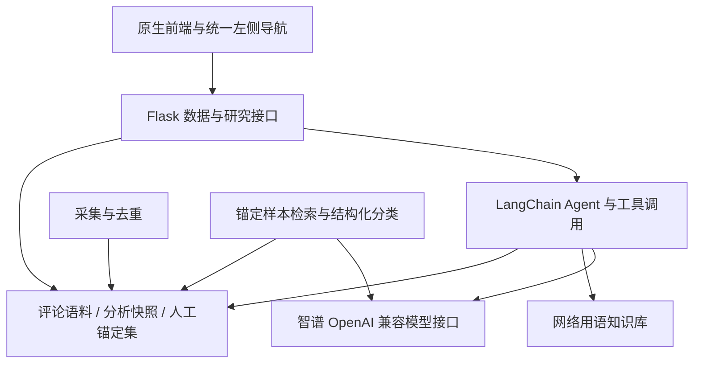

***从社区评论出发，为网络治理与立法研究提供可追溯的证据。***

<p align="center"></p>
<h1 align="center">破妄 · 社区评论与网络治理研究平台</h1>

围绕视频社区中的情感表达、重复话术和社区冲突，提供评论分析、证据检索与人工复核，辅助研究人员形成网络治理和立法研究问题。模型分类是研究线索，不能据此认定用户身份、付费行为或违法事实。

## 功能

- 📊 数字经济观察：官方来源的 GDP 占比环形图、规模与增长趋势，区分信通院广义口径与国家统计局核心产业口径。
- 🔎 社区深度洞察：六分类分布、时间趋势、网络用语和关系图谱。
- 🗂️ 评论证据库：按视频、分类、关键词检索，查看评论详情并衔接人工复核。
- ✍️ 人工标注：锚定样本、追加标注与二次审查，支持导出微调训练数据。
- 🤖 数据问答：基于 LangChain Agent 查询本地统计和网络用语知识库，回答社区研究问题。
- 📄 治理研究：法规来源、研究路径，以及研究摘要和立法研究提纲导出。

当前随库研究快照覆盖 2 个视频、7,199 条评论及 107 条人工锚定记录。它们不代表全网样本，模型置信度不等于准确率。界面沿用电光蓝、荧光青、紫色、品红与粗边框风格，页面入口统一位于左侧。

## 安装与启动

需要 [Python 3.10 或以上](https://www.python.org/downloads/)，建议使用虚拟环境。前端为原生 HTML、CSS、JavaScript，无需 Node 构建。

```powershell
git clone https://github.com/heart06215/media_society_comment_research.git
cd media_society_comment_research
python -m venv .venv
.\.venv\Scripts\python.exe -m pip install -r requirements.txt
.\.venv\Scripts\python.exe project_main.py --mode serve
```

浏览器打开 [本地首页](http://127.0.0.1:5000/)。默认使用公开示例参数，可直接浏览随库统计、图谱和评论；调用模型时再设置密钥。

## 使用

| 页面 | 地址 | 用途 |
| --- | --- | --- |
| 治理总览 | `/` | 数字经济、社区研究、法规来源、摘要导出与 AI 助手 |
| 社区深度洞察 | `/insight` | 统计对比、趋势、热词及评论关系图谱 |
| 评论证据库 | `/comments` | 搜索评论与查看详情 |
| 人工标注与复核 | `/label` | 标注研究样本与复核模型标签 |

建议先从首页查看样本规模与官方数据，再进入社区洞察，筛选线索并在证据库核对上下文，最后进行人工复核和研究摘要导出。所有子页面均可通过左侧导航进入。

命令行支持以下入口。`crawl` 会访问外部平台，`analyze` 会调用模型并更新分析结果；使用前自行确认数据范围和 API 用量。

```powershell
python project_main.py --mode stats
python project_main.py --mode crawl --bvid BV1fy4y1L7Rq
python project_main.py --mode analyze --bvid BV1fy4y1L7Rq --limit 100
python project_main.py --mode export
```

## 配置

应用先读 `data/config.example.json`，再用可选的 `data/config.json` 覆盖，最后读取进程环境变量 `ZHIPU_API_KEY`。实际密钥和 Cookie 文件均被 Git 忽略。

```powershell
$env:ZHIPU_API_KEY = "你的智谱 API 密钥"
.\.venv\Scripts\python.exe project_main.py --mode serve
```

[环境变量模板](.env.example) 仅供参考，应用不会自动加载 `.env`。模型服务使用 OpenAI 兼容接口，默认地址指向智谱；模型名称和可用性以服务商账户为准。

| 配置项 | 位置 | 示例默认值 / 用途 |
| --- | --- | --- |
| `ZHIPU_API_KEY` | 进程环境变量 | 无；优先于 JSON 中的密钥 |
| `PORT` | 进程环境变量 | `5000`，服务端口 |
| `api_key` | 本地 JSON | 无真实默认值；推荐用环境变量 |
| `model` | JSON | `glm-4-flash`，基础分类及问答模型 |
| `fallback_model` | JSON | `glm-4-flash-250414`，分类限流后的备用模型 |
| `base_url` | JSON | `https://open.bigmodel.cn/api/paas/v4/` |
| `fine_tuned_model` | JSON | 空字符串；填写已训练完成的模型 ID 后优先使用 |
| `concurrency` | JSON | `12`，批量分析并发数，使用正整数 |
| `videos` | JSON | 视频列表：`bvid`、`name`、`community`、`community_full`、`color` |

采集模块的可选登录 Cookie 放在本地 `data/cookie.txt`，不提交到仓库。服务器默认只监听 `127.0.0.1`，供本地研究使用。

## 技术架构



主要代码：[`app.py`](app.py) 提供接口，[`sentiment_analyze.py`](sentiment_analyze.py) 完成分类与锚定检索，[`agent_chat.py`](agent_chat.py) 提供问答工具，[`comment_graph.py`](comment_graph.py) 生成关系图数据。当前检索使用字符相似度与领域词条，微调导出和模型 ID 接入不等于已经完成微调效果验证。

官方经济数据为截至 2024 年的已发布历史数据，来源与口径见[前端升级与资料来源](docs/前端升级与资料来源.md)。评论及派生标签用于研究，不作为个体定性依据；对外展示应遵循原平台规则并减少可识别信息。

## 项目资料

- [参赛评分与后续工作](docs/参赛评分与后续工作.md)：按指定赛道评分项安排下一步工作与提交材料。
- [前端升级与资料来源](docs/前端升级与资料来源.md)：官方数据、法规、获奖项目参考与界面说明。
- [开发记录](docs/开发记录.md)：已有开发过程记录。
- [论文写作素材与实验设计手册](论文写作素材与实验设计手册.md)：实验组织参考，具体结论以复现实验为准。

## 团队信息

仓库维护者：[heart06215](https://github.com/heart06215)。参赛团队成员、学校、组别及指导教师信息以正式报名登记为准。
