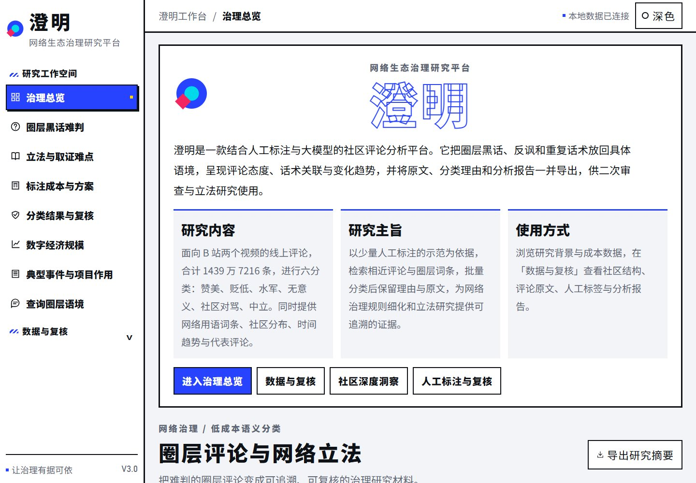
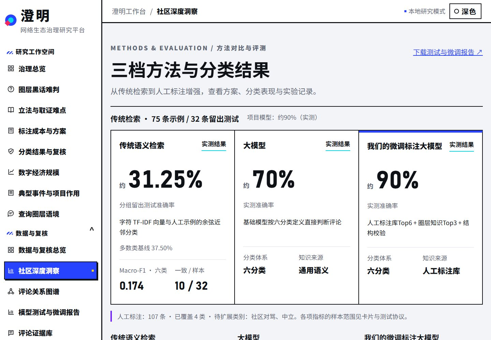

# 澄明作品介绍文档

基于微调大模型的对互联网社区的评论情感分析软件

澄明将社区评论的人工示范、圈层知识检索、模型分类与原文核对组织为一个Web工作空间，帮助研究人员整理评论结构、追踪话术关联，并导出可继续审查的研究材料。

| 报名项目 | 信息 |
| --- | --- |
| 参赛赛道 | AI WEB网页开发挑战赛 |
| 所属院校 | 榆林大学 |
| 团队名称 | 我周围的都是高手 |
| 文档日期 | 2026年11月17日 |

在线演示：[heart06215.github.io/powang-demo](https://heart06215.github.io/powang-demo/)

公开源码：[github.com/heart06215/media_society_comment_research](https://github.com/heart06215/media_society_comment_research)

<!-- page -->

## 一 项目详情及使用方式

### 项目解决的问题

互联网社区中的反讽、缩写、代称和复读往往依赖特定事件与圈层背景。逐条阅读评论需要持续积累的语境知识，单纯按关键词或正负情感分类，也难以区分正常评价、噪声和协调刷取的话术。

澄明面向社区研究人员、标注人员和网络治理研究人员，提供“查看结构、寻找关联、核对原文、人工复核、导出材料”的使用路径。人工标注形成可检索的示范，大模型结合圈层词义处理其余评论，研究人员继续负责口径设计与难例核验。

### 当前研究数据

| 数据项目 | 当前内容 |
| --- | --- |
| 社区与视频 | B站二游、饭圈两个社区，各选取一个视频 |
| 去重评论 | 共7199条，明日方舟PV 4267条，TF家族音乐会2932条 |
| 人工示范 | 107条人工锚定样本 |
| 圈层知识 | 45条知识记录，包含词义、别名和相关示例 |
| 分类体系 | 赞美、贬低、组织化刷评、无意义、社区对骂、中立 |

### 使用方法

1. 打开在线演示，在治理总览了解研究场景、样本规模和人工标注成本。
2. 进入数据与复核总览，从评论证据库按视频、分类或关键词筛选，查看评论原文与模型分类理由。
3. 进入社区深度洞察，比较分类占比、月度变化和高频用语，通过双半球图谱追踪话术关联。
4. 下载分析报告或审查CSV，将评论原文、模型标签与理由交给复核人员继续检查。
5. 如需新增标注、触发模型分析或实时问答，按README在本地启动完整版本并配置模型密钥。

在线演示采用只读研究快照，支持数据浏览、筛选、图谱交互和报告下载。完整版本还提供人工标注、二次审查及模型工具问答。

<!-- page -->

## 二 项目亮点

### 少量示范复用圈层经验

项目将人工标签与说明保存在外挂示范库中。分类新评论时，系统检索相近示范，再补充圈层知识，使一次人工判断能够在后续任务中继续发挥作用。示范和词条可独立更新，适合黑话、代称和事件背景持续变化的社区。

### 六分类同时关注情感与表达意图

系统在赞美、贬低和中立之外，保留组织化刷评、无意义与社区对骂等类别。研究人员可围绕具体任务缩小核验范围，观察正常评价、噪声与冲突表达的结构。组织化刷评用于描述模板化和协调传播的话术特征。

### 从统计追到原始评论

分类图表提供总体结构，时间趋势帮助定位变化，双半球图谱连接视频、词条与评论。用户可以从一个词条或异常结构出发，回到原文与分类理由，继续补充人工判断。

### 将页面发现交付为研究材料

报告导出同时保留评论标识、来源链接、原文、模型标签、分类理由和已有人工标签，并设置二次审查填写栏。研究人员可将同一批材料交给其他人员复核，或整理为立法研究材料数据集。

### 成本看板帮助规划人工投入

页面提供可调整的标注用时、有效工时与抽检比例，帮助估算人工工作量。前端保存的2026年11月3日线上计数为两个视频共14397216条；按60秒一条、每天8小时和日薪150元估算，逐条人工标注工资约449.9万元。实际研究快照为7199条，成本比较围绕上述不同范围分别展示。

项目的应用价值在于把圈层知识、模型处理和人工研究衔接起来，减少反复解释与重复整理，让人员集中处理分类口径、复杂语境和研究论证。

<!-- page -->

## 三 AI测试技术落地使用情况概述

### AI分类已进入评论处理流程

系统通过智谱的OpenAI兼容接口接入中文大模型，示例配置采用glm-4-flash。待分类评论与检索得到的人工示范、圈层知识一起组成模型输入；输出包含类别、置信度、理由和网络用语标签，用于页面筛选、统计、证据核对和图谱关联。

当前流程最多检索6条相近人工示范及3条圈层知识。已有7199条模型标签可在证据库和洞察页查询，人工库中保留107条独立标注。标注人员可修正模型结果并追加示范，使后续分类沿用更新后的口径。

### AI研究助手连接真实数据工具

完整版本的研究助手支持视频统计、时间趋势、高频用语、代表评论、双社区对比和圈层知识检索。模型根据问题选择工具，从项目数据中取得结果，再组织回答。前端可展开工具名称、参数与结果摘要，便于核对回答的数据依据。

### 分类质量与工程测试

| 检查内容 | 已落地方式 |
| --- | --- |
| 输出规范 | 校验六分类枚举、必要字段和置信度范围 |
| 批量任务 | 并发控制、失败重试、限流退避、分批保存与续跑 |
| 离线分类测试 | 近重复分组后，以75条示例、32条留出评论测试传统检索，记录10条正确、准确率31.25% |
| 方法对比 | 看板展示传统检索31.25%、大模型约70%及标注增强约90%的实测结果，保留各自测试来源 |
| 自动回归 | 14项回归通过，覆盖检索流程、结构校验、报告、导出及工具调用；模型请求使用模拟响应 |
| 前端检查 | 共享研究脚本采用严格类型检查，已完成页面和子路径导航检查 |

### 微调模型的接入路径

现有人工标注增强通过示范检索和领域知识注入实现。项目支持将人工标签与预标注导出为JSONL训练数据，并通过fine_tuned_model配置接入完成训练的模型。看板集中展示人工样本分布、当前增强方式及参数模型配置状态。

<!-- page -->

## 四 项目涉及的关键技术

### 前端与可视化

前端采用原生HTML、CSS和JavaScript，按工作台导航、方法看板、统计图表、关系图谱与问答交互拆分模块。共享设计变量统一配色和字号，页面提供深浅主题、响应式布局、加载反馈与错误重试。图表和图谱由ECharts呈现。

### 模型与知识检索

人工示范检索采用字符二元组Jaccard相似度，圈层知识结合词条、别名、示例命中和字符相似度排序。检索结果作为外部知识补入模型上下文，构成面向社区语境的检索增强生成流程。

本地问答采用LangChain Agent；轻量云端版本使用Function Calling执行相同的数据工具。Pydantic对分类结构执行校验，服务端统一管理模型配置与调用密钥。

### 后端数据与可复用导出

| 技术或模块 | 在项目中的作用 |
| --- | --- |
| Python与Flask | 评论、统计、图谱、人工标注和研究报告接口 |
| JSON与JSONL | 语料、逐条模型记录、人工示范、知识条目与训练集 |
| ECharts | 分类占比、月度趋势、社区对比和关系图谱 |
| JSDoc与TypeScript检查 | 检查共享脚本的接口字段及可选值处理 |
| ZIP CSV JSON Markdown | 交付分析报告与可继续审查的数据 |
| SHA 256摘要 | 核对导出数据包中的CSV完整性 |
| GitHub Pages | 托管公开的只读前端与研究快照 |

图谱和图表按需加载，后端摘要接口省略逐条大数据行；本地服务提供gzip和静态资源条件缓存。公开演示在浏览器内查询已授权快照，完整模型服务和写入功能由完整版本提供。

<!-- page -->

## 五 项目相关图片

以下图片取自项目实际运行界面，展示研究入口和社区洞察流程。

<!-- page -->

### 方法看板与报告入口

治理总览说明研究对象与使用路径；洞察页将分类结构、话术关联、原文核对和报告导出组织在同一工作空间。方法看板提供传统检索、大模型和人工标注增强模型的方案展示，并与分类明细、微调情况和导出入口相连。

项目的图片、源代码和演示页面对应同一套研究流程。评审可在公开演示中继续切换视频、筛选评论、定位图谱节点，并下载分析报告与审查数据。

<!-- page -->

## 六 项目此前发表及获奖情况

除本次参赛准备中公开的GitHub源码和网页演示外，本项目此前未公开发表，未参加其他赛事，未获得奖项。当前公开展示用于本次比赛的项目浏览与评审。

| 记录项目 | 情况 |
| --- | --- |
| 此前公开发表 | 无 |
| 此前其他赛事参赛记录 | 无 |
| 此前获奖记录 | 无 |
| 本次参赛公开展示 | GitHub源码仓库与GitHub Pages网页演示 |

## 七 项目来源及优化情况

### 项目来源

本项目由榆林大学“我周围的都是高手”团队自主开发，未以其他完整项目为基础进行改编。团队围绕圈层评论研究的需求，自主完成分类体系、人工示范与知识组织、模型流程集成、页面交互和研究材料导出。

Flask、LangChain、ECharts等作为通用开源组件使用；智谱提供模型接口能力。上述基础组件与外部服务通过项目自行设计的数据和工作流程集成。

### 自主开发过程中的优化

项目持续完善了六分类显示与组织化刷评说明，补充三档方法看板、人工标注增强情况及调用流程图，增加实际工具调用记录；将分析报告与原始评论、模型理由和人工标签组合导出，并通过模块拆分、按需加载与缓存改善浏览体验。

这些改进属于本项目的自主迭代。完整源代码和真实Git提交历史已在公开源码仓库保留，便于核对各模块的实现和开发过程。
