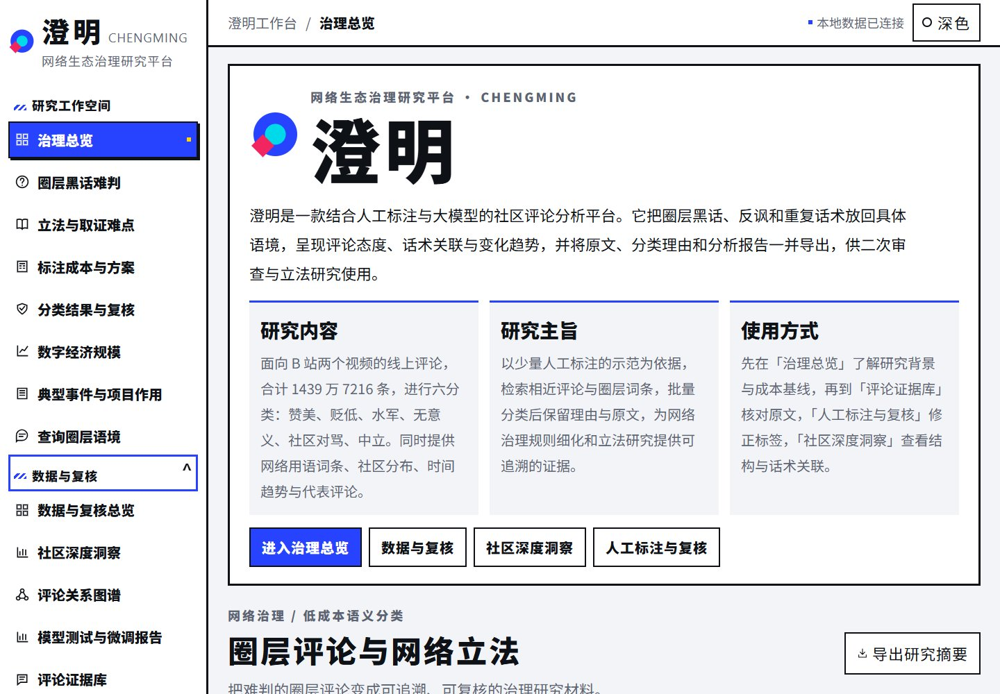
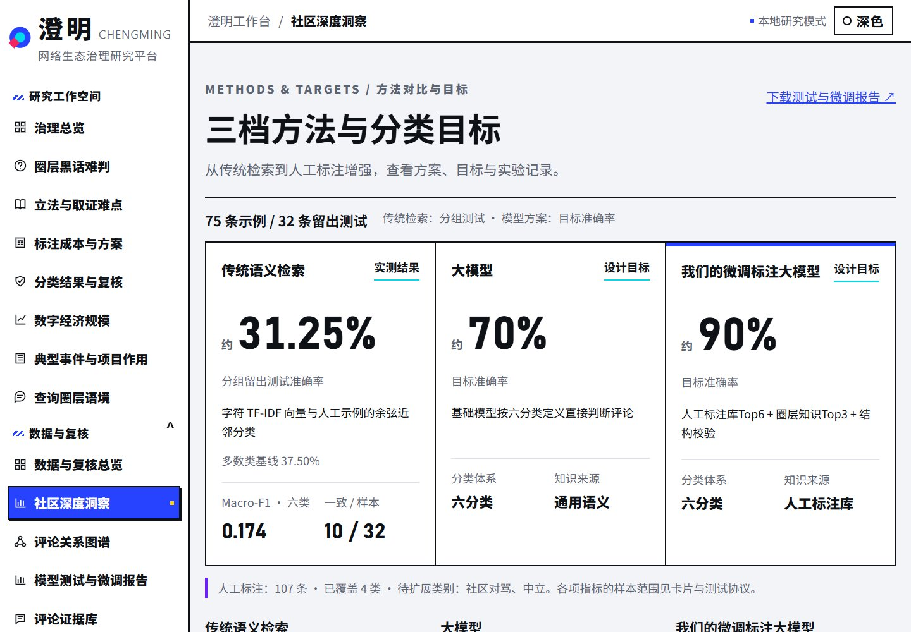

# 澄明 · 社区评论与网络治理研究平台

基于微调大模型的对互联网社区的评论情感分析软件

参赛技术文档 | 2026年11月17日 | V3.0

让圈层表达被理解，让网络治理有依据。

项目围绕圈层黑话、反讽与复读，组织人工示范、知识检索、模型分类、证据图谱与研究报告导出，将分散评论转为可追溯、可复核、可继续研究的数据材料。

代码仓库：https://github.com/heart06215/media_society_comment_research

项目维护：heart06215

参赛院校：榆林大学；团队：我周围的都是高手；组别：B组。


<!-- page: contents -->

## 阅读导航

| 章节 | 内容 | 页码 |
| --- | --- | --- |
| 一 | 项目概述 | 3 |
| 二 | 需求分析 | 4 |
| 三 | 系统架构设计 | 5 |
| 四 | AI技术方案：模型、检索与Agent | 6-8 |
| 五 | 核心功能实现：工作台、图谱与报告 | 9-13 |
| 六 | 测试与部署 | 14-15 |
| 七 | 创新点、总结与展望 | 16-17 |

### 项目主线

研究人员先在治理总览了解问题与成本，再进入评论证据库核对原文，在人工标注页补充示范或修正标签，随后通过社区深度洞察分析结构与关联，最后导出分析报告和二次审查数据集。

### 文档范围

本文对应当前仓库内的四个主要页面及其后端接口。内容覆盖已实现的使用路径、AI集成方式、工程组织与部署方法。界面截图取自本地运行版本。

文中线上评论量采用前端保存的2026年11月3日计数；本地语料量按随库数据统计。三档方法的指标口径与看板一致，模型方案的目标准确率与已记录的测试结果分别列示。

<!-- page: overview -->

## 一、项目概述

### 1.1 项目定位

澄明是一套面向互联网社区评论的研究工作台。它将情感与表达意图归为六类，并把类别、理由、圈层词义及原始评论连接起来，为社区运营、网络治理研究与立法研究提供材料整理工具。

评论中的缩写、代称、谐音和反讽依赖社区背景。单独阅读一句话，往往无法确定表达对象与真实立场。项目将少量人工标注示范作为可复用知识，再由大模型完成批量分类与语境解释。



### 1.2 当前数据与成果

| 项目 | 当前范围 |
| --- | --- |
| 研究对象 | B站两个视频，覆盖二游与饭圈两个社区 |
| 本地去重语料 | 7199条：明日方舟PV 4267条，TF家族音乐会2932条 |
| 已有模型标签 | 7199条，前端可查询类别与分类理由 |
| 人工锚定样本 | 107条，作为示范检索与人工复核的基础 |
| 圈层知识 | 45条知识记录，保存词条、释义及相关示例 |
| 研究交付 | 结构图表、关系图谱、工具问答、分析报告与证据数据集 |

<!-- page: requirements -->

## 二、需求分析

### 2.1 用户与任务

| 使用者 | 主要问题 | 系统提供的支持 |
| --- | --- | --- |
| 社区研究人员 | 评论量大，难以逐条阅读与比较 | 六分类分布、时间趋势、代表评论与双社区对比 |
| 标注及复核人员 | 黑话依赖经验，分类口径难以复用 | 人工示范库、同源原文、模型理由与标签修正 |
| 网络治理研究人员 | 线索散落，材料难以追溯和交接 | 来源链接、评论标识、词条关联及结构化导出 |
| 项目维护人员 | 模型和数据更新容易影响页面 | 统一配置、共享接口、独立前端模块与部署快照 |

### 2.2 功能需求

系统支持按视频、分类和关键词定位评论；展示分类占比与月度变化；检索人工示例与网络用语；生成带类别、理由和置信度的分类记录；保存人工标注与二次审查；通过自然语言调用统计和知识工具；导出报告及可继续填写的审查数据。

组织化刷评作为六分类中的直接输出类别，用于标注模板化、协调刷取及重复传播的话术特征。系统沿用历史数据键“水军”，前端主要显示为“组织化刷评”，保持旧数据和新界面的兼容。

### 2.3 质量要求

查询应及时反馈读取状态，失败时提供重试入口；桌面与手机共享清晰导航；图谱与长页面避免一次性加载全部重资源；API密钥通过环境变量或本地配置管理；导出材料保留来源和分类字段，便于后续人员接续审查。

### 2.4 任务闭环

结构观察 → 话术关联 → 原文核对 → 人工示范与复核 → 分析报告导出。每一步都能回到具体评论，人工修正可继续补入示范库，使后续模型分类沿用更新后的口径。

<!-- page: architecture -->

## 三、系统架构设计

### 3.1 分层设计

前端采用原生HTML、CSS与JavaScript，后端采用Flask。数据以JSON、JSONL组织，适合当前研究快照的本地运行与只读部署。模型通过OpenAI兼容接口接入，问答工具与批量分类分别组织。

<!-- diagram: architecture -->

| 层次 | 主要模块 | 责任 |
| --- | --- | --- |
| 表现层 | landing / comments / label / insight | 治理总览、证据查询、人工操作、结构与关联展示 |
| 服务层 | app.py / research_reports.py | 数据查询、分类任务、研究报告与导出 |
| AI层 | sentiment_analyze / agent_chat / agent_runtime | 结构化分类、Agent问答与Function Calling |
| 检索层 | AnchorRetriever / SlangKnowledgeBase | 相近人工示范与圈层词条检索 |
| 数据层 | crawled / analysis / labels / evaluation | 原始语料、模型记录、人工标签和评测配置 |

### 3.2 数据流与部署对应

采集模块取得评论后按视频整理与去重。分类模块读取人工示范和领域知识，调用模型，将结果保存为逐条记录与统计快照。页面通过API读取统计、评论与关系图，报告模块统一生成可下载材料。

本地版提供标注、复核及分析写入；云端版使用public静态页面与cloud-functions只读快照。共享报告和工具模块使两个版本使用相同的字段与研究口径。

<!-- page: llm -->

## 四、AI技术方案

### 4.1 模型选型与集成

项目选择支持中文理解和OpenAI兼容接口的智谱模型服务，示例配置采用glm-4-flash。选择依据是中文评论理解、结构化输出接入便利，以及当前样本实践可使用的免费模型额度。模型名称、服务地址、并发数和备用模型集中配置，便于更换服务。

分类与问答均在服务端调用模型。ZHIPU_API_KEY由进程环境变量读取，浏览器通过项目接口获取结果。fine_tuned_model配置用于接入训练完成的参数微调模型；当前页面同时展示人工标注增强方式与参数模型配置状态。

### 4.2 提示词与输出协议

系统提示词定义六类判定口径和网络用语背景，用户提示词包含待分类原文、最多6条人工示范及最多3条圈层知识。模型输出包含category、confidence、reason和slang_tags，分别用于分类筛选、人工检查与图谱关联。

| 处理环节 | 实现策略 | 作用 |
| --- | --- | --- |
| 类别约束 | 固定六分类枚举 | 统一页面、统计与导出的标签体系 |
| 格式校验 | Pydantic校验结构和置信度范围 | 识别缺字段、未知类别及异常数值 |
| 请求恢复 | 格式失败重试、限流退避及备用模型 | 减少批量任务中断 |
| 批量执行 | 并发控制、分批保存与续跑 | 适应较长的评论分析任务 |
| 结果保留 | 原文、类别、理由和词条标签一起保存 | 支持原文核对和分析复用 |

### 4.3 三档方法展示

| 展示档位 | 处理方式 | 看板指标 |
| --- | --- | --- |
| 传统语义检索 | 字符TF-IDF与余弦近邻分类 | 分组留出测试约31.25%，10/32条正确 |
| 大模型 | 按六分类定义直接判断 | 目标准确率约70% |
| 我们的微调标注大模型 | 人工示范、圈层知识与结构校验共同增强 | 目标准确率约90% |

<!-- page: rag -->

### 4.4 人工示范与RAG

项目将人工标注库与圈层知识库分别检索，再组合为模型上下文。人工示范回答“类似表达应如何分类”，圈层知识回答“词语在这个社区中是什么意思”。两类信息共同补足单句中缺少的背景。

人工示范按评论字符二元组的Jaccard相似度检索，优先使用同一视频的标注记录，最多取6条，并兼顾类别参照。领域知识结合词条、别名和示例命中与字符相似度排序，最多取3条；知识内容作为提示词中的背景资料。

| 分类 | 表达含义 | 当前人工样本 |
| --- | --- | --- |
| 赞美 | 对人物、作品或事件表达肯定 | 37 |
| 贬低 | 表达否定、嘲讽或批评 | 18 |
| 组织化刷评 | 模板化、协调刷取或重复传播的话术特征 | 13 |
| 无意义 | 灌水、噪声或缺少有效语义的表达 | 39 |
| 社区对骂 | 社区或群体间的对抗表达 | 0 |
| 中立 | 信息陈述或无明显态度 | 0 |

### 4.5 知识更新与优化

外挂人工标注库可直接追加和修正，维护人员无需为每次口径调整重新训练参数。标注页中的解释和修正保存为示范后，可供后续检索复用。知识条目独立维护，便于补充新梗、别名和时间背景。

当前检索使用可在本地轻量运行的字符方法，便于展示参照依据和维护成本。后续可在相同接口下接入语义向量检索与重排，并在独立测试集上比较检索质量。

### 4.6 微调数据衔接

export_finetune.py将人工标签与模型预标注组织为JSONL训练数据。训练完成后填写模型标识即可沿用分类接口、结果存储及前端看板。当前已接入的人工标注增强属于上下文学习，参数模型配置和训练记录由微调情况面板单独呈现。

<!-- page: agent -->

### 4.7 Agent与工具调用

研究助手支持分类统计、时间趋势、高频用语、代表评论、双视频对比和圈层知识检索。模型根据问题选择工具，工具从本地研究数据取回结果，再由模型组织回答。回答下方可展开工具名、参数、状态和结果摘要。

<!-- diagram: workflow -->

| 工具 | 用户任务示例 |
| --- | --- |
| get_video_stats | 查询一个视频的六分类数量和占比 |
| get_trend | 查询月度分类变化 |
| get_top_slang | 查找高频圈层用语 |
| get_representative | 取回某类代表评论和理由 |
| compare_videos | 比较二游与饭圈的分类结构 |
| search_slang | 解释“砌墙”等词条及相关示例 |

本地版采用LangChain Agent；云端版通过Function Calling执行相同的数据工具。云端问答设置调用轮次和总时限，避免工具查询无限循环。两种实现均将实际工具记录交给前端展示。

### 4.8 安全与可控性

模型输出经过结构校验，失败请求保留失败状态。问答仅能选择已注册的数据工具，评论原文按数据处理。研究报告将模型标签、人工标签和二次审查结论分列，便于审查人员核对与更正。

面向公开演示，可开启只读模式、问答限额及API访问控制。导出采用字段白名单，保留研究所需的原文与来源，省略昵称、IP和配置密钥。

<!-- page: workbench -->

## 五、核心功能实现

### 5.1 治理总览与成本看板

首页以“圈层黑话难判”为起点，串联立法与取证问题、人工标注成本、分类结果、数字经济背景和真实事件资料。法规与案例条目附来源链接，研究人员可从页面跳转查阅；研究摘要和立法研究提纲可直接导出。

成本计算器支持调整单条用时、每日有效时间与抽检比例。以线上评论量作预算输入，用统一公式计算逐条人工标注的日通量、工日和工资，帮助用户理解少量示范复用的实际意义。

| 输入或结果 | 前端基准 |
| --- | --- |
| 线上计数快照 | 两视频合计14397216条，记录于2026-11-03 |
| 人工假设 | 60秒/条，每天8小时，日薪150元 |
| 单人日通量 | 8 × 3600 ÷ 60 = 480条 |
| 全量工作量 | 分视频向上取整后合计29995工日 |
| 全量工资 | 29995 × 150 = 4499250元，约449.9万元 |
| 当前样本实践 | 7199条去重语料，作者独立完成，使用免费模型额度 |

页面中的当前成本约0元按已有样本实践统计，个人时间未折算。线上全量工资用于预算比较；招聘培训、数据归档与研究论证等后续投入可继续细化。

### 5.2 导航与展示

统一左侧导航将研究叙事与数据工具分区。顶部显示当前页面与数据连接状态。竞技风格滚动条串联圈层语义、三档方法和报告导出等主题，延续项目的电光蓝、荧光青、紫色与粗边框视觉。

<!-- page: evidence -->

### 5.3 评论证据库

评论页支持按视频、六分类和关键词筛选，并提供六分类数量与占比。研究人员可查看原文、时间、分类理由和来源，在统计发现与具体评论之间来回核对。视频与评论标识贯穿查询、人工标注和导出。

### 5.4 人工标注与二次审查

标注页提供人工示范采集与模型结果复核两条操作路径。标注人员选择类别、填写说明并保存，形成独立人工记录；已有模型结果可按需要调出复核，修正后继续扩充示范库。

组织化刷评保持直接分类输出，人员可在原文与相近表达中检查模板化话术。现有二次审查功能用于研究人员主动复核，不为该类新增中间分类。

| 操作阶段 | 输入 | 形成的记录 |
| --- | --- | --- |
| 定位评论 | 视频、分类或关键词 | 可追溯的原始评论与模型解释 |
| 建立示范 | 人工类别与说明 | anchors中的独立人工标注 |
| 批量分类 | 原文、示范和圈层知识 | 模型类别、理由、置信度及词条 |
| 二次审查 | 原文、模型结果及人工判断 | 修正分类与审查说明 |
| 研究交接 | 指定视频或当前整体范围 | 报告、CSV、JSON与清单 |

### 5.5 一条完整使用路径

研究人员先在洞察页发现组织化刷评占比，再进入证据库筛选对应类别，检查原文与模型理由；对语境不明的表达查看词条和相近示范，补充人工标注；最后导出包含原文、已有标签和审查栏的数据集，供另一位研究人员继续核验。

这一流程保留统计与文本之间的联系，使标签修正、证据整理和报告制作在同一工作空间内完成。

<!-- page: insight -->

### 5.6 社区深度洞察

洞察页包含六分类占比、样本量、按月堆叠趋势、高频网络用语与代表评论。切换至对比模式后，同一页展示两个社区的数量、占比差、结构雷达与差异摘要，便于先定位值得追踪的表达。


### 5.7 双半球语义图谱

图谱将两个视频组织为左右双半球，围绕视频、词条与评论展示关联。用户可搜索词条、视频或评论，按视频筛选，切换评论节点、文本相似边和提及边；点击节点后查看释义与来源，再进入原文核验。

关系图由comment_graph.py及接口整理数据，前端采用ECharts呈现。字符Jaccard相似度用于文本关联，词条命中用于评论与知识节点连接。颜色对应类别或视频，节点大小反映点赞或命中规模。

这种交互把聚合统计与单条评论连接起来，适合追踪跨社区共用词、同类话术与具有时间背景的表达。

<!-- page: export -->

### 5.8 方法看板与调用流程

治理总览和洞察页共用三档方法看板，集中展示方法说明、指标口径、人工样本分布与微调情况。分类明细支持选择方法；有分类指标时展示精确率、召回率与F1，有设计目标时展示对应目标。



调用流程图以“分类与标注、数据问答、报告与研究”三条分支呈现输入、检索、模型调用与交付路径。问答后再补充本次工具调用摘要，帮助用户核对答案所用的数据。

### 5.9 分析报告与数据集导出

| 导出内容 | 用途 |
| --- | --- |
| report.md | 汇总样本范围、方法记录、微调情况与研究说明 |
| comments.csv | 原文、来源、模型标签与理由、人工标签、二次审查空白栏 |
| manifest.json | 记录导出范围、条数及CSV的SHA-256摘要 |
| benchmark.json | 保存已有离线评测和方法记录 |

接口支持ZIP、CSV、JSON与Markdown，并可按视频限定范围。CSV对公式开头的文本作电子表格转义，JSON保留原文。导出包可交给复核人员继续填写，也可作为立法研究材料数据集，用于讨论分类尺度、语境证据和审查程序。

<!-- page: engineering -->

### 5.10 前端工程与用户体验

前端延续原生Web技术路线，将长页面中的看板、图谱、问答和样式按职责拆分。共享模块统一分类显示名、请求处理、图表加载和工具记录，减少多个页面对同一逻辑的重复实现。

| 模块 | 职责 |
| --- | --- |
| workspace.js / base.css | 导航、工作台框架、主题及公共设计变量 |
| research-core.js | 请求合并、短时缓存、图表依赖及工具轨迹展示 |
| research-dashboard.js / research.css | 方法卡片、微调报告、流程图与导出区域 |
| insight-dashboard.js | 分类统计、对比图表与代表评论 |
| insight-graph.js | 图谱数据读取、筛选、搜索与节点交互 |
| insight-chat.js | 洞察页问答、提交状态与结果展示 |

共享研究脚本采用JSDoc和独立类型声明，以TypeScript严格模式进行检查。Node仅用于开发检查，本地Python应用运行无需前端构建。

### 5.11 性能与交互策略

图谱在接近视口时加载，图表依赖按需获取；分析摘要接口省略逐条原始行，完整记录由证据查询和导出接口提供。相同请求进行合并，并使用短时缓存；后端提供gzip压缩和静态文件ETag条件缓存。

页面提供读取、空状态、错误反馈和重试入口。筛选采用原生表单控件，导航支持键盘使用，深浅主题共享颜色变量。减少动态效果设置可降低滚动和入场动画强度。

首页内容按区块滚动呈现，光标轨迹与内容框配合展示研究步骤；图表与工具页保持直接操作路径。移动端将导航和多列内容收拢，长表格在自身容器内滚动。

<!-- page: testing -->

## 六、测试与部署

### 6.1 功能检查与回归范围

项目保留本地自动回归与前端类型检查，覆盖数据划分、输出协议、报告、导出、接口及工具调用。提交前13项自动回归与前端严格类型检查均通过。测试使用模拟模型响应，检查数据流与异常处理，不依赖外部模型请求。

| 检查范围 | 主要检查点 |
| --- | --- |
| 评测数据 | 近重复分组、固定划分、失败请求计入分母 |
| 输出协议 | 未知类别、缺字段、异常置信度的拒收 |
| 模型流程 | 同视频示范检索、圈层知识注入与结构化解析 |
| 报告数据 | 目标与实测字段分离、历史记录口径保留 |
| 导出材料 | 模型与人工标签分列、公式转义、字段白名单 |
| 本地与云端 | 报告范围、ZIP条数、无效格式响应 |
| 工程性能 | 摘要接口、gzip、静态资源条件缓存 |
| 工具问答 | Function Calling执行及轨迹回传 |

### 6.2 现有分类记录

传统语义检索采用固定种子42，将近重复话术分组后划分为75条训练侧示例和32条留出评论。当前正确10条，准确率31.25%，六类Macro-F1约0.174。32条测试集覆盖四类；中立与社区对骂需继续补充人工样本。

看板中大模型约70%、人工标注增强模型约90%为设计目标，由独立配置文件提供。报告保存现有方法记录，未执行的模型配对测试不生成实测分数。

### 6.3 复现命令

```powershell
npm ci --ignore-scripts
npm run check:types
python -m unittest discover -s tests -v
python evaluation.py
```

evaluation.py默认执行离线流程。当前桌面和320px宽度页面已进行检查；本轮提交前再次检查核心页面与已有回归项。

<!-- page: deployment -->

### 6.4 安装与本地启动

运行环境为Python 3.10及以上。requirements.txt提供Python依赖，.env.example说明环境变量；配置示例位于data/config.example.json。

```powershell
python -m venv .venv
.\.venv\Scripts\python.exe -m pip install -r requirements.txt
$env:ZHIPU_API_KEY = "你的智谱API密钥"
.\.venv\Scripts\python.exe project_main.py --mode serve
```

启动后访问http://127.0.0.1:5000。随库快照可直接用于统计、证据和图谱浏览。应用读取进程环境变量，不自动加载.env文件；调用模型时使用服务端配置的密钥。

| 配置项 | 用途 |
| --- | --- |
| ZHIPU_API_KEY | 模型调用密钥 |
| PORT | 本地服务端口，默认5000 |
| model / base_url | 基础模型名称与兼容接口地址 |
| fine_tuned_model | 已完成训练的模型标识 |
| concurrency | 批量分类并发数 |
| POWANG_READ_ONLY | 公开演示时关闭数据写入与分析触发 |
| POWANG_CHAT_LIMIT | 控制公开演示的问答次数 |

### 6.5 只读部署与版本维护

执行python scripts/prepare_edgeone.py，将front复制到public，将允许的研究快照与共享后端模块同步到cloud-functions。生成脚本在替换目录前核对绝对路径，并生成不含API密钥的公开配置。

EdgeOne版本保留查询、图谱、报告导出与限额问答，禁用标注保存、删除和分析写入。本地版用于完整研究操作，云端版用于评审浏览。公网地址、可用期限和模型额度由实际部署环境配置。

密钥与Cookie文件保持Git忽略。提交时保留真实开发历史，并使技术文档、演示视频和代码对应同一功能版本。Dockerfile与Procfile提供其他Python托管方式的部署入口。

<!-- page: innovation -->

## 七、创新点与应用价值

### 7.1 技术创新点

| 创新点 | 实现方式 | 对研究工作的价值 |
| --- | --- | --- |
| 双库语境增强 | 人工分类示范与圈层知识分别检索、联合注入 | 同时提供判定口径与词义背景 |
| 人机反馈闭环 | 模型理由、人工修正与示范追加相互衔接 | 将稀缺的圈层经验继续复用 |
| 证据关联交互 | 六分类图表、双半球图谱、原文入口联动 | 从总体差异快速定位具体表达 |
| 可移交研究数据 | 原文、模型标签、人工标签和审查栏分列导出 | 支持跨人员复核与后续分析 |

### 7.2 应用创新点

项目把研究焦点从简单的正负情感扩展到表达意图、组织化话术和圈层语境。六分类同时保留正常评价、噪声与群体冲突等类型，使研究人员能够按任务选择核验范围。

成本看板将人工判断的规模问题具体化；调用流程与工具记录让用户看到回答依据；可导出的分析报告使页面观察能够继续进入二次审查和立法研究材料整理。

### 7.3 社会价值与商业潜力

对于高校研究团队，系统可用于课程研究、语料标注和案例整理；对于社区运营团队，可用于比较话术变化和整理人工复核材料；对于网络治理研究团队，可辅助分析认定尺度、语境证据与材料留存需求。

可持续服务方向包括专题语料整理、圈层知识维护、私有部署和研究报告交付。当前技术路线允许替换模型服务和采集入口，后续按实际用户任务核算数据维护、人工复核、接口调用和托管成本。

<!-- page: outlook -->

### 7.4 总结

澄明已形成“少量人工示范、语境检索、模型分类、结构洞察、原文复核、报告交付”的研究流程。四个主要页面共同完成数据读取、人工操作和成果导出，后端提供一致的数据与模型接口。

当前成果包括7199条去重评论的可查询快照、107条人工示范、45条圈层知识、六分类结构图表、双社区关系图谱、带工具调用记录的研究助手，以及供二次审查和立法研究使用的导出数据包。

### 7.5 后续展望

| 方向 | 后续工作 |
| --- | --- |
| 数据覆盖 | 扩充中立、社区对骂及更多社区的人工样本 |
| 模型优化 | 接入完成训练的参数模型，并保留独立测试结果 |
| 检索质量 | 比较字符检索、语义向量与重排策略 |
| 多模态语境 | 在现有数据结构中补充字幕、图像等上下文 |
| 多平台迁移 | 按平台重写采集与字段映射，沿用示范、分类和导出流程 |
| 协作能力 | 增加持久化存储、多人标注与口径版本管理 |

### 7.6 项目资料与页面入口

| 入口 | 路径 |
| --- | --- |
| 治理总览 | / |
| 数据与复核 | /workbench |
| 评论证据库 | /comments |
| 人工标注与复核 | /label |
| 社区深度洞察 | /insight |
| 方法与微调报告 | /insight#evaluation |
| 报告与数据集 | /api/research/export?format=zip |

项目安装、架构和维护信息见README；研究报告与导出说明见docs/模型测试与报告.md；只读部署配置见docs/EdgeOne部署.md和docs/GitHub Pages部署.md。本文及PDF依据当前仓库功能整理，团队信息于2026年11月17日按报名记录补齐。
